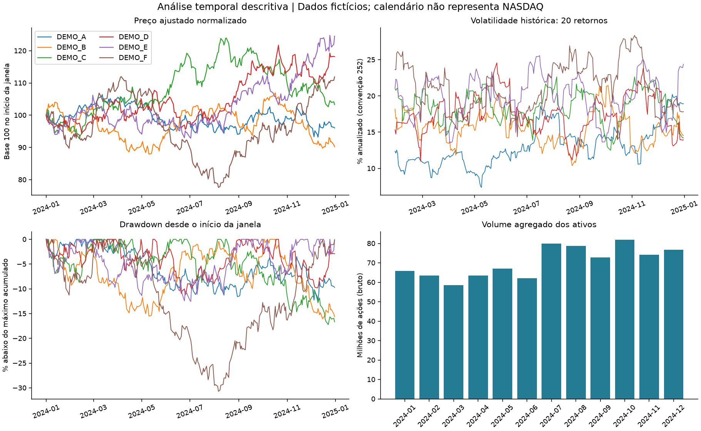

# Bolsa de Valores — análise temporal e BI

Demonstração reproduzível de análise de séries financeiras com **Python, Pandas, SQL e SQLite**. Seis ativos integralmente fictícios permitem verificar retornos, agregações mensais, volatilidade, momentum, drawdown e qualidade dos dados, sem provedores externos ou contas de investimento.

## História do projeto e evidência pública

O projeto original descrevia um painel Power BI para análise histórica de ações NASDAQ, com filtros por empresa/período, OHLC, volume negociado, comparação mensal e narrativa inteligente. Uma captura disponível nos materiais do portfólio mostra essa apresentação visual. O repositório, porém, continha apenas README: os dois commits antigos não forneciam Python, dados, DAX, Power Query ou PBIX recuperáveis.

As empresas listadas no README antigo divergem dos filtros legíveis na captura. Por isso, a versão pública não afirma reproduzir o universo, as medidas ou os resultados daquele painel. O contexto de análise temporal e storytelling foi preservado; a implementação abaixo é **uma reconstrução nova com dados fictícios**, não código original recuperado.

O Smart Narrative, os filtros e as medidas Power BI pertencem ao contexto histórico relatado e parcialmente mostrado. Esta versão entrega gráficos estáticos e narrativa descritiva em Python; não afirma execução de Power BI Desktop ou validação de DAX. Também não comprova desempenho de investimentos ou melhoria de decisões comerciais.

## O que foi implementado

- Contrato de uma cotação por ativo/sessão, com cobertura declarada, OHLC coerente e volume inteiro.
- Retorno diário e mensal de preço ajustado somente por split, separado da variação da média mensal do fechamento bruto.
- Base 100, volatilidade histórica, momentum e drawdown com janelas explícitas e valores ausentes quando o cálculo não é definido.
- SQLite real com dimensões de ativo/data, fato de cotação, chaves, restrições e carga transacional.
- Consultas SQL mensais reconciliadas com Python antes da publicação.
- Gerações de arquivos com hashes e manifesto: falhas preservam a última saída confirmada.
- Notebook executável, testes automatizados e workflow de validação preparado.



## Execução rápida — Python 3.12

Na raiz do repositório:

```bash
python -m venv .venv
```

Ative no Windows PowerShell com `.\.venv\Scripts\Activate.ps1`; no Linux/macOS, `source .venv/bin/activate`.

```bash
python -m pip install -r requirements-lock.txt
python -m pip check
python scripts/run_demo.py
python scripts/run_tests.py
python scripts/validate_notebook.py
```

São necessários Python 3.12 e SQLite 3.37 ou superior, fornecido pela biblioteca padrão nas instalações utilizadas na validação. Não há servidor de banco, credencial, API de cotação ou Power BI necessários para a demonstração. A instalação pode precisar de internet; a execução da análise não baixa dados.

O lock inclui as ferramentas de validação do notebook. `requirements.txt` declara o núcleo; `requirements-dev.txt` acrescenta dependências de desenvolvimento. O [notebook](notebooks/analise_temporal.ipynb) chama os mesmos módulos usados pelos testes.

## Dados fictícios e ajuste de preços

O gerador cria DEMO_A a DEMO_F, sem relação com empresas reais, usando semente 42. O intervalo demonstrativo é 2024, com calendário de segunda a sexta-feira. **Esse calendário inclui possíveis feriados reais e não representa sessões oficiais NASDAQ.** Os valores expressos em USD são inventados.

DEMO_A tem um split fictício 2:1: o preço bruto muda mecanicamente, enquanto a série ajustada preserva o processo simulado. O volume permanece em ações brutas. Não há ajuste por dividendos, impostos ou custos; os retornos são de preço e não de retorno total de investimento.

As [entradas publicadas](examples/README.md) são geradas pelo mesmo código. A CLI executa somente a demonstração; não existe coletor de mercado ou importação automática de dados reais. A API Python aceita o contrato documentado, mas a declaração de sessões e origem continua sendo responsabilidade de quem fornece os dados.

## Indicadores e significado

| Indicador | Definição e limite |
| --- | --- |
| Retorno diário | Preço ajustado atual / anterior − 1, por ativo; primeiro valor ausente |
| Retorno mensal de preço | Último preço ajustado observado / último do mês anterior consecutivo − 1 |
| Variação da média mensal bruta | Média do fechamento bruto / média do mês anterior − 1; não equivale ao retorno mensal |
| Base 100 | Preço ajustado / primeiro preço do ativo na janela × 100 |
| Volatilidade móvel | Desvio-padrão amostral de 20 retornos × raiz de 252; anualização é uma convenção |
| Momentum 21 | Preço ajustado / preço de 21 observações atrás − 1; sem sinal de negociação validado |
| Drawdown | Preço ajustado / máximo acumulado desde o início da janela − 1 |
| Volume | Quantidade bruta de ações, não dinheiro movimentado ou medida completa de liquidez |

Percentuais são armazenados como frações: 0,10 representa 10%. A completude mensal é relativa à cobertura declarada. Meses parciais são sinalizados; mês anterior ausente não é substituído por zero. Não são somados preços de empresas diferentes como medida de desempenho.

## Saídas confirmadas

Consulte `outputs/demo/latest.json`; a chave `directory` aponta para a geração completa:

| Artefato | Conteúdo |
| --- | --- |
| cotacoes_indicadores.csv | Cotações e indicadores diários por ativo |
| mensal.csv | Agregações, duas variações mensais distintas e flags de cobertura |
| resumo_ativos.csv | Resumo descritivo por ativo e intervalo |
| ativos.csv | Dimensão de ativos fictícios |
| bolsa.sqlite | Modelo dimensional, metadados e views SQL |
| validacao.json | Cobertura, configuração, versões, hash da entrada e reconciliação SQL |
| narrativa.txt | Resumo determinístico dos valores computados |
| painel.png e retornos_mensais.png | Gráficos explicitamente fictícios |

Saídas locais não são versionadas por padrão. Os [artefatos de evidência](docs/evidence/README.md) foram selecionados de uma execução sintética confirmada. Consumidores devem usar o manifesto e conferir hashes; não escolher a pasta mais recente por nome.

## Arquitetura e SQL

```text
Gerador offline + calendário declarado
                 ↓
Contrato e cobertura por ativo/data
                 ↓
Pandas: séries, janelas e agregações
                 ↓
SQLite: dimensões + fato + views mensais
                 ↓
Reconciliação SQL/Python e gráficos
                 ↓
Geração imutável → latest.json confirma
```

`src/bolsa/` contém a implementação; `sql/001_schema.sql` define o modelo e as views. As chaves de negócio são ativo/data. Cada snapshot é carregado em transação, sem DROP de tabelas ou publicação parcial. SQLite é testado de fato; não se apresenta essa validação como homologação PostgreSQL.

## Validação, BI e limites

Consulte [validação efetivamente realizada](docs/VALIDACAO.md), [contrato](docs/CONTRATO_DADOS.md), [metodologia](docs/METODOLOGIA.md), [reprodução](docs/REPRODUCAO.md), [guia Power BI](docs/POWER_BI.md) e [segurança/procedência](SECURITY.md).

O workflow instala as versões fixadas, verifica dependências, executa testes, demonstração e notebook. A presença do arquivo de workflow não comprova execução remota: o estado observado é registrado no relatório de validação.

Esta implementação é descritiva e educacional. Não inclui cotações reais, backtest, previsões, sinais de compra/venda, carteira, reinvestimento de dividendos, conversão cambial ou comprovação de resultados financeiros. A narrativa em Python não é o recurso Smart Narrative do Power BI.
