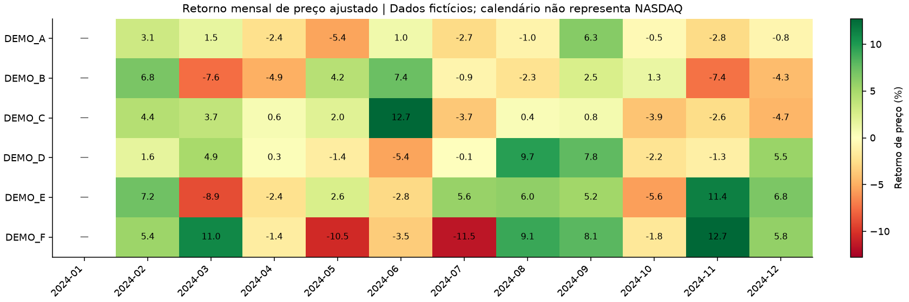

# Validação e registro das alterações

Data: 20/10/2026. Base auditada: main em baaba47611c24b5bcc14d02be957761c131a4f9f.
Estado: proposta na branch fix/profissionalizacao-bolsa para revisão; integração na main ainda não realizada. As evidências abaixo registram a validação local anterior à publicação.

## Entregas por arquivo

| Arquivos | Resultado |
| --- | --- |
| src/bolsa/contracts.py | Tipos, domínios, OHLC, chaves, calendário, cobertura e política de ajuste explícitos |
| src/bolsa/synthetic.py e examples/ | Seis ativos fictícios e evento de split demonstrativo, sem dados originais |
| src/bolsa/analytics.py | Retornos, agregações, volatilidade, momentum, drawdown e narrativa descritiva |
| sql/001_schema.sql | Dimensões de ativo/data, fato, restrições e duas views de agregação/retorno mensal |
| src/bolsa/database.py | SQLite real, carga transacional, integridade e reconciliação SQL/Python |
| src/bolsa/pipeline.py | Gerações, hashes e confirmação por manifesto, preservando publicação anterior sob falha |
| src/bolsa/plots.py | Painel estático e matriz mensal com identificação de dados fictícios |
| notebooks/analise_temporal.ipynb | Sete células executáveis usando a implementação testada, sem saídas versionadas |
| scripts/ e tests/ | Execução offline, notebook temporário e testes de fórmulas, SQL e falhas |
| requirements*.txt | Dependências diretas e instalação fixada, sem bibliotecas não utilizadas de ML ou APIs |
| .github/workflows/tests.yml | Workflow preparado para suíte, demonstração e notebook completo |
| README.md, docs/ e SECURITY.md | Contexto original preservado e diferenciado das evidências novas |

O repositório original tinha apenas README. Não se afirma recuperar código, dados, DAX ou PBIX antigos. A captura histórica foi examinada nas Fontes, sem republicá-la. Nenhum sistema corporativo foi acessado.

## Ambiente e testes executados

- Windows, Python 3.12.14; SQLite 3.53.1 real via sqlite3 da biblioteca padrão.
- NumPy 2.5.4, Pandas 3.0.6, Matplotlib 3.11.2.
- Primeira instalação isolada pelas faixas de requirements-dev.txt; segunda instalação em ambiente vazio diretamente por requirements-lock.txt. pip check aprovado nas duas.
- Suíte final: **61 testes nas duas instalações**, sem falhas, erros ou testes ignorados. Tempos: 24,438 segundos na primeira e 26,510 segundos na segunda.
- Inclui 13 testes dedicados a SQLite real: foreign keys, chaves, restrições, repetição, rollback sob falha de inserção, reconciliação e mês ausente.
- Notebook: sete células executadas integralmente nas duas instalações; publicação sintética confirmada e kernel temporário encerrado.
- Demonstração concluída nas duas instalações, com SQL/Python reconciliados antes da confirmação do manifesto.
- Workflow verificado com actionlint 1.7.12; nenhuma execução GitHub Actions alegada antes da publicação.
- Quinze arquivos Python analisados sintaticamente e dezessete links locais conferidos; notebook sem saídas versionadas e scan direcionado dos fontes aprovado.
- Gráficos examinados visualmente: títulos, unidades, legenda e rótulos legíveis, indicação de dados fictícios e primeiro retorno mensal ausente.

A primeira suíte intermediária passou com 55 testes. A revisão de tipos/metadados acrescentou seis testes e a versão final passou com 61 em ambos os ambientes. Não houve erro de fórmula ocultado, integração real ou execução inventada.

## Resultado observado da demonstração

| Medida de integridade | Resultado |
| --- | --- |
| Ativos fictícios | 6 |
| Sessões por ativo do calendário fictício | 262 |
| Cotações com chave ativo/data | 1572 |
| Linhas mensais reconciliadas SQL/Python | 72 |
| Calendário | Segunda a sexta de 2024; não é calendário NASDAQ |
| Ajuste de preços | Split only, sem dividendos |
| Primeiro retorno por ativo | Ausente |
| Primeiro retorno mensal por ativo | Ausente |

Essas contagens são da demonstração, não de uma carteira ou mercado real. Variações de preços fictícios não são apresentadas como desempenho de investimento.

Os testes com resultados conhecidos comprovam, entre outros casos:

- Preços 100 → 110 → 99 geram retornos +10% e −10%, mas retorno composto −1%, e não zero.
- Preços 100 → 120 → 90 → 108 geram drawdown mínimo −25% na janela.
- Split fictício com bruto 100 → 50 e ajustado 50 → 50 não gera perda artificial na série ajustada.
- Duas médias mensais podem variar enquanto os últimos preços dos dois meses permanecem iguais; as métricas não são confundidas.
- Mês anterior ausente, primeira observação e janela insuficiente não viram retorno zero.
- Falha SQL no meio da inserção restaura o snapshot anterior; falha de SQL, gráfico ou manifesto não troca latest.json.

## Evidências

Veja [instalações](evidence/instalacoes.json), [resultado da suíte](evidence/tests-result.json), [notebook](evidence/notebook-result.json), [validação da geração](evidence/validacao.json), [resumo por ativo](evidence/resumo_ativos.csv) e [narrativa descritiva](evidence/narrativa.txt). São evidências locais sintéticas, não resultados remotos ou comerciais.

## Limitações e pendências

- Publicação e PR dependem de autorização; merge terá aprovação separada. CI ainda precisa de primeira execução no GitHub.
- Não há cotações NASDAQ reais, download de mercado ou comprovação de retorno de empresas.
- Calendário fictício não exclui feriados; a integridade de sessões reais precisaria de fonte e calendário autorizados.
- Ajuste somente por split; dividendos, taxas, impostos, carteira e retorno total não estão incluídos.
- Não há previsão, backtest ou validação de sinal de negociação.
- Power BI Desktop, DAX, Power Query e Smart Narrative não foram executados nesta reconstrução; há guia de consumo e gráficos estáticos verificados.
- SQLite e Python foram testados; isso não é homologação de PostgreSQL ou de uma arquitetura de produção concorrente.
- A referência de base 100/drawdown e o resumo textual são da janela da geração; filtrar um visual não recalcula automaticamente essas referências.
- Nenhuma mudança foi feita no repositório Portf-lio ou no README do perfil.
